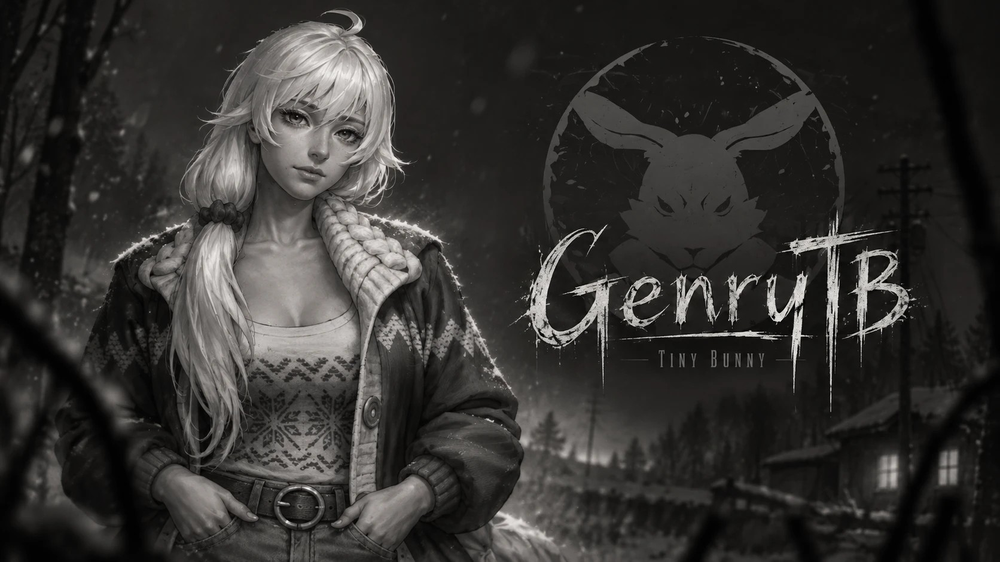
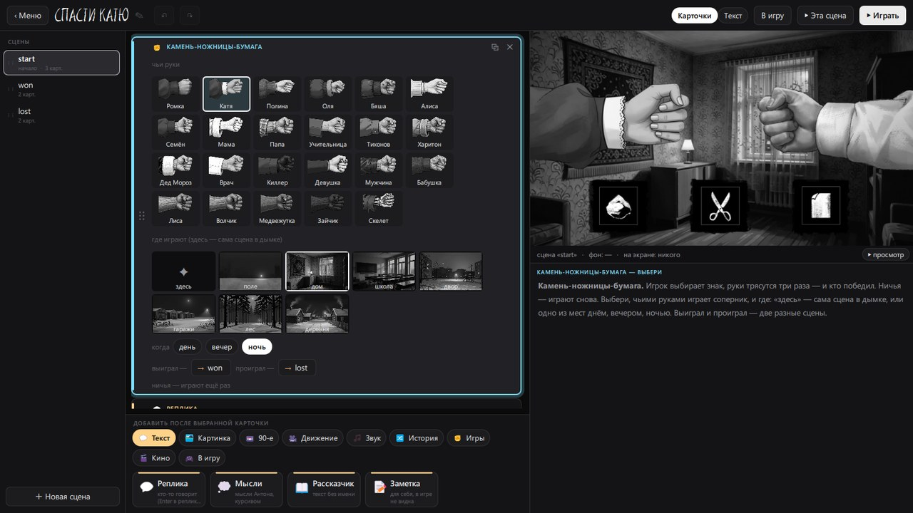

# GenryTB — конструктор модов «Зайчика» (Tiny Bunny)

**[English below](#english)** · **[Вики](https://github.com/GenryTheFox0/GenryTB/wiki)** · **[Скачать](https://github.com/GenryTheFox0/GenryTB/releases/latest)**

> ⚠️ **Нужна купленная игра.** GenryTB работает только с установленной лицензионной
> **«Зайчик» / Tiny Bunny** из Steam — [store.steampowered.com/app/1421250](https://store.steampowered.com/app/1421250/).
> Игра стоит около 510 ₽, поддержите её авторов. В GenryTB нет ни одного файла игры: картинки, спрайты, музыку,
> звуки и голоса он читает прямо из вашей установленной копии.

GenryTB — бесплатный конструктор модов для «Зайчика» с открытым кодом: свои истории, вставки в оригинальные эпизоды,
другие концовки. Программировать не нужно: мод собирается из карточек, превью сразу показывает кадр так, как его
нарисует игра.

   
   

<i>Редактор · суефа руками Кати на ночной дороге · «Найдена живой» · полароид — из мода-примера «Спасти Катю»</i>

### Что умеет
- **Карточки вместо кода**: реплики, фоны, персонажи, выборы, музыка, звуки — всё из самой игры. Или текстом,
  если так быстрее: [шпаргалка команд](docs/commands.md).
- **Живое превью** каждого кадра: камера, движения персонажей, снег, VHS-плёнка, телевизор, воспоминания.
- **Механики игры**: выбор подсветкой на картинке, выбор на время, записка, объявление «Пропал ребёнок»,
  камень-ножницы-бумага (руки 23 персонажей, 7 мест днём, вечером и ночью), пазл, полароид, телефон с набором номера,
  загадка, осмотр места, борьба, предмет в руке, эпилог с артом концовки, титры.
- **Свои фишки**: достижения мода, камера за мышью.
- **Моды поверх оригинала**: `@вставка` — своя сцена перед любой меткой игры, `@замена` — свой поворот сюжета.
  Пример — мод «Спасти Катю»: в игре Катя гибнет при любом раскладе, здесь — нет, если быть к ней человеком раньше.
- **20 языков интерфейса** (русский, English, українська, беларуская, қазақша, polski, čeština, Deutsch, français,
  español, português, italiano, türkçe, 日本語, 简体中文, 繁體中文, 한국어, tiếng Việt, Bahasa Indonesia, ไทย).
- Мод ставится в игру одной кнопкой: в главном меню игры появляется «Моды».

### Как начать
1. Купите и установите «Зайчика» в Steam.
2. Скачайте **`GenryTB_Setup.exe`** из [Releases](https://github.com/GenryTheFox0/GenryTB/releases/latest) и запустите
   (или `GenryTB_portable.zip` без установки).
3. «Новый мод» → карточки → «▶ Играть». По шагам: [первый мод за 10 минут](docs/first-mod.md).

### Документация
[Вики](https://github.com/GenryTheFox0/GenryTB/wiki): установка, первый мод, все команды, мини-игры, камера и
эффекты, моды внутри оригинала, вопросы и проблемы. Те же страницы лежат в [`docs/`](docs/README.md).

### Сборка из исходников
Windows, MSVC 2022, Qt 6.8, CMake + Ninja. Подробно: [для разработчиков](docs/developers.md).
Помочь проекту: [CONTRIBUTING](CONTRIBUTING.md).

### Связь
Новости, моды, вопросы — Telegram: [t.me/teamgenrythefox](https://t.me/teamgenrythefox).
Баги и идеи — [Issues](https://github.com/GenryTheFox0/GenryTB/issues).

Код — [GPL-3.0](LICENSE). Шрифты в `data/fonts` — SIL Open Font License 1.1 и Apache 2.0.

---

# GenryTB — a mod maker for Tiny Bunny

> ⚠️ **You need to own the game.** GenryTB only works with an installed, legally bought copy of
> **Tiny Bunny** from Steam — [store.steampowered.com/app/1421250](https://store.steampowered.com/app/1421250/).
> GenryTB ships none of the game's files: it reads pictures, sprites, music, sounds and voices straight from your
> own copy.

GenryTB is a free, open-source mod maker for Tiny Bunny: your own stories, inserts into the original episodes, other
endings. No programming: a mod is built from cards, and the preview shows each frame the way the game will draw it.

- Cards instead of code; a live preview of every frame (camera moves, character motions, snow, VHS, TV, memories).
- The game's own mechanics (glowing picture choices, timed choices, notes, «missing» posters, rock-paper-scissors
  with the hands of 23 characters in 7 places at three times of day, a jigsaw puzzle, polaroid, a phone to dial,
  riddles, look-around, struggle, an item in hand, endings, credits) plus its own (achievements, mouse-follow camera).
- Mods on top of the original game: `@вставка` / `@замена` hooks into any label of the game. The sample mod
  «Save Katya» lets you save the girl the game always kills.
- 20 interface languages. One button installs the mod; the game's main menu gets «Mods».
- The story's commands are Russian words in every language (`фон`, `показать`, `выбор`), so a mod written anywhere
  opens everywhere; in the cards you never see them.

**Get it:** `GenryTB_Setup.exe` from [Releases](https://github.com/GenryTheFox0/GenryTB/releases/latest)
(or `GenryTB_portable.zip`). **Build:** Windows, MSVC 2022, Qt 6.8, CMake + Ninja — see
[docs/developers.md](docs/developers.md). **Docs:** the [wiki](https://github.com/GenryTheFox0/GenryTB/wiki) (Russian).
**News:** Telegram [t.me/teamgenrythefox](https://t.me/teamgenrythefox).

Code: [GPL-3.0](LICENSE). Fonts in `data/fonts`: SIL Open Font License 1.1 and Apache 2.0.

*Tiny Bunny belongs to its authors. GenryTB is a fan project, not affiliated with the game's developers.*
