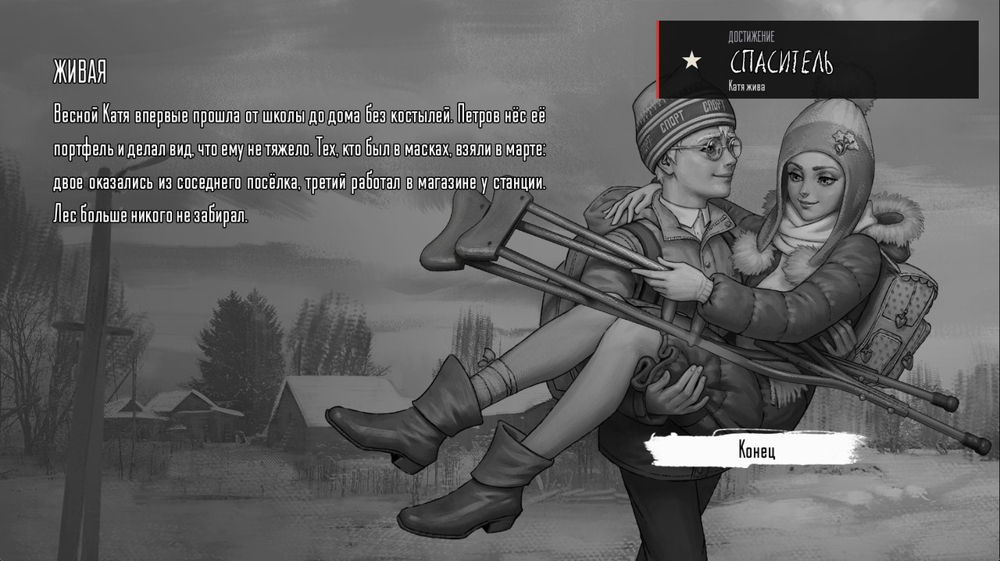

# Выборы, очки и концовки

[← Вики](README.md)

## Обычный выбор

```
выбор
- Поверить Оле -> believe
- Отмахнуться -> ignore
конецвыбора
```

Игрок видит варианты и выбирает один. История уходит в сцену по стрелке. В карточке «Выбор» варианты двигаются
мышкой, а сцену «куда» можно создать прямо из стрелки.

## Выбор подсветкой на картинке

Так выбирают в самой игре: на картинке светятся пятна с подписями.

```
выбор подсветка
- ВЗЯТЬ -> candy | 960 760
- ОТКАЗАТЬСЯ -> refuse | 1500 240
конецвыбора
```

Числа — точка на экране 1920×1080. В карточке точку не надо считать: её ставят мышкой прямо на превью.

## Выбор на время

```
выбор время 8
- Догнать её -> e3_walk
- Не лезть не в своё дело -> e3_let
конецвыбора
```

На выбор дано 8 секунд (от 1 до 60). Не успел — сработает **последний** вариант. Поэтому последним ставь то, что
бывает, «если промолчать».

## Очки и условия

Мод помнит числа: смелость, дружбу с Полиной, сколько конфет взял.

```
установить доверие 0
прибавить доверие 1
убавить доверие 1
если доверие >= 2 -> e3_wait
```

`если` уводит в сцену, когда условие выполнено. Если нет, история идёт дальше по карточкам. Сравнения: `>=`, `<=`,
`>`, `<`, `=`, `!=`. Счётчики живут внутри твоего мода и не путаются с другими модами.

## Достижения

```
достижение Рыцарь | Проводил Катю мимо гаражей
```

В углу выезжает кубок с названием и строчкой под ним. Каждое достижение даётся один раз и навсегда. В меню «Моды»
у мода видно, сколько собрано: ★ 1/2.

## Кнопка

```
кнопка Открыть дверь
```

История останавливается и ждёт, пока игрок нажмёт кнопку с этой надписью. Без текста на кнопке будет «ДАЛЬШЕ».

## Концовка

```
эпилог images/end/kaite/bg.png + images/end/kaite/chara.png | ЖИВАЯ | Весной Катя впервые прошла от школы до дома без костылей. | Конец
титры Сценарий: Генри | Спасибо, что играли
конецигры
```

- **`эпилог`** — страница концовки, как в самой игре: арт (картинки концовок игры, слои через `+`), заголовок, текст
  и кнопка. Короче: `эпилог Текст | Кнопка` — на затемнённой сцене.
- **`титры`** — строчки плывут снизу вверх по чёрному экрану. Каждая часть между `|` — отдельная строка. Щелчок их
  пропускает.
- **`конецигры`** — музыка стихает, на чёрном появляется «Конец», и игра возвращается в главное меню.

<p align="center"></p>
