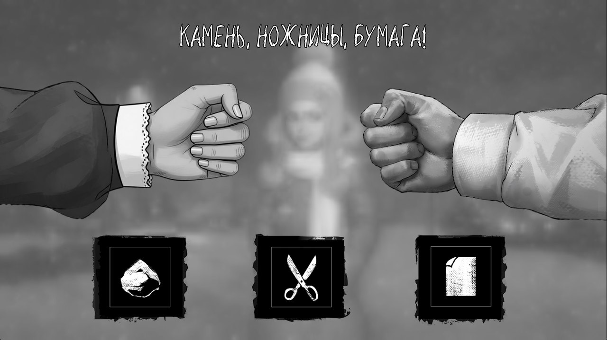
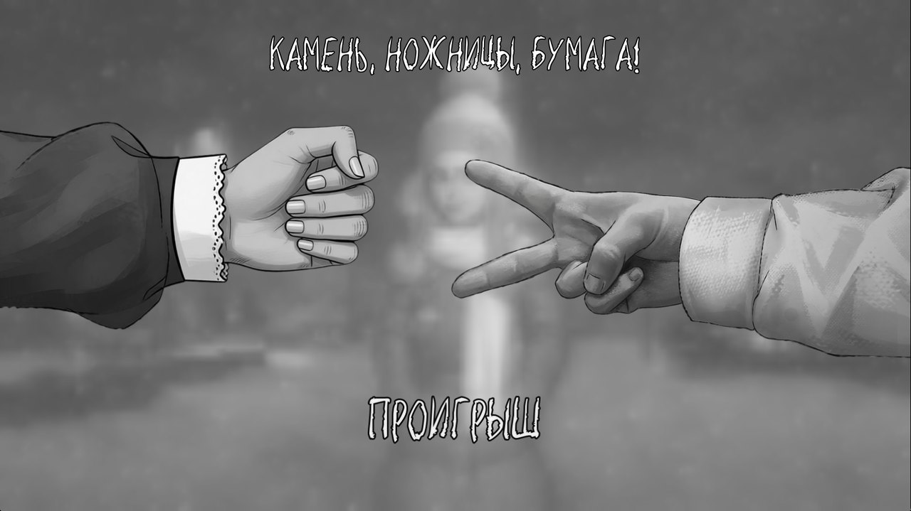
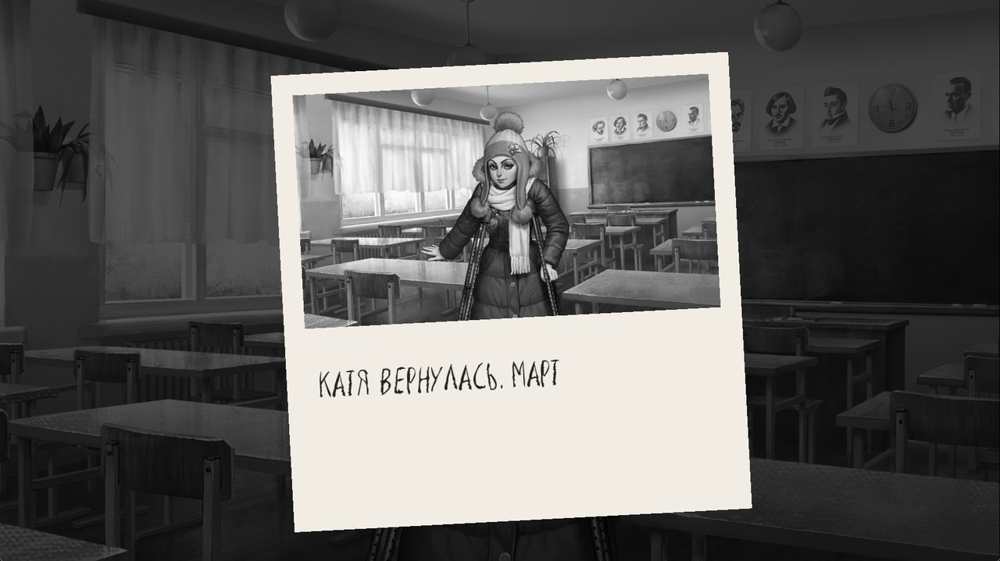
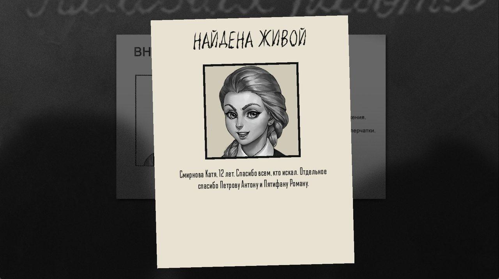

# Мини-игры

[← Вики](README.md)

## Камень-ножницы-бумага (суефа)

<p align="center"> </p>

```
суефа Катя | двор ночь -> e3_rps_win | e3_rps_lose
```

Игрок выбирает знак, руки трясутся три раза, и становится видно, кто победил. Ничья — играют снова. Выиграл и
проиграл — две разные сцены.

**Чьими руками играет соперник** — 23 набора. Каждый перерисован под персонажа: женские руки тоньше, с аккуратными
ногтями и рукавом кофты, мужские грубее и с костяшками, у зверей лапы.

| | | | |
|---|---|---|---|
| Ромка (как в игре) | Катя | Полина | Оля |
| Бяша | Алиса | Семён | Мама |
| Папа (или Отец) | Учительница | Тихонов | Харитон (или Дед) |
| Дед Мороз | Врач | Киллер | Девушка |
| Мужчина | Бабушка | Лиса | Волчик |
| Медвежутка | Зайчик | Скелет | |

Без имени играет Ромка, как в игре.

**Где играют:**

- ничего не писать или `здесь` — сама сцена, размытая и затемнённая;
- `поле` — родное поле из мини-игры «Зайчика»;
- `дом`, `школа`, `двор`, `гаражи`, `лес`, `деревня`, `поле` + `день`, `вечер` или `ночь` — 21 нарисованное место,
  например `гаражи вечер`;
- любой фон игры по имени.

В карточке «Суефа» руки и места выбираются по миниатюрам.

## Пазл

```
пазл images/end/kaite/bg.png | 3x3 -> solved
```

Картинка рвётся на куски и рассыпается по столу из мини-игры с плакатом Полины. Игрок перетаскивает куски, и у
своего места кусок защёлкивается. Когда собрано всё, история идёт в сцену по стрелке. Размер от `2x2` до `5x5`,
без размера будет 3x3. Картинка — файл игры (`images/...`) или фон по имени, слои через `+`. В углу есть кнопка
«Собрать сразу» для тех, кто застрял.

## Телефон

```
телефон
- 31677 -> call_kate
- 20202 -> call_police
- неправильно -> wrong_number
конецтелефона
```

Тот самый кнопочный телефон из пятого эпизода. Игрок сам набирает номер, и каждый номер ведёт в свою сцену. Все
номера одной длины. Если набран не тот номер, оператор скажет «Неправильно набран номер», а строка
`- неправильно -> сцена` уводит в свою сцену. Номер подсказывай заранее: в записке, на объявлении, в реплике.

## Загадка

```
загадка Зимой и летом одним цветом | ёлка/ель -> right | wrong
```

Игрок вписывает ответ на листке. Верных ответов может быть несколько, через `/`. Регистр и «ё» не важны.

## Осмотр

```
осмотр
- Плита | 900 600 | Холодная. Мама сегодня не готовила.
- Окно | 1400 300 | За стеклом никого. Только следы на снегу.
- Уйти | 1700 900 -> street
конецосмотра
```

На картинке светятся точки, игрок наводит и щёлкает. Точка с описанием показывает строчку и возвращает к осмотру.
Точка со стрелкой уходит в другую сцену. Хотя бы один выход нужен, иначе из осмотра не выбраться.

## Борьба

```
борьба Тяни! | 6 -> pulled | too_late
```

Полоска выскальзывает, игрок жмёт пробел или кликает, чтобы её удержать. Заполнил до конца — первая сцена, не успел
за 6 секунд — вторая. Так в игре вытаскивают из мясорубки.

## Полароид

```
снимок Катя вернулась. Март
```

Антон поднимает полароид, вспышка, и на экране карточка с этим самым кадром и твоей подписью. Как в третьем эпизоде.

<p align="center"></p>

## Предмет в руке

```
предмет images/end/kaite/chara.png | Вкладыш от жвачки
```

Снизу поднимается рука Антона и держит фотокарточку с любой картинкой игры. Висит, пока игрок не щёлкнет.

## Записка и объявление

```
записка Не ходи в лес. Он тебя уже ждёт.
объявление Катя Kawai m_day 00 good ahead 02 | НАЙДЕНА ЖИВОЙ | Смирнова Катя, 12 лет.
```

**Записка** — лист с нацарапанными словами. **Объявление** — листок «Пропал ребёнок» с фотографией персонажа. Фото
берётся из спрайта: просто имя (`объявление Алиса | …`) или конкретное лицо, как в примере. Без заголовка будет
«ПРОПАЛ РЕБЁНОК».

<p align="center"></p>
